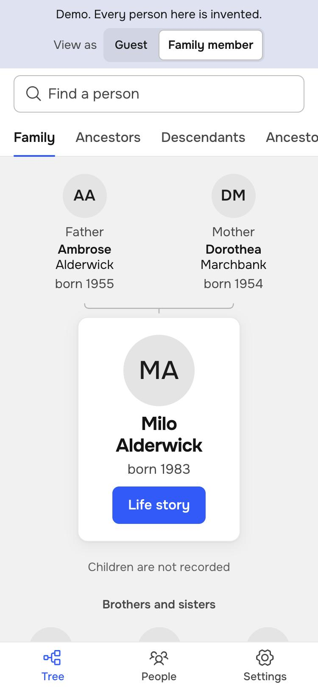
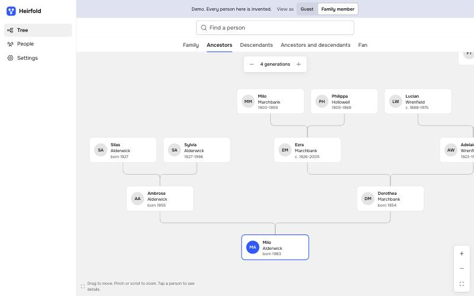

# Heirfold

Heirfold is a private website for your family tree. You run it on your own server. It reads Gramps files, runs as one binary and hides living people from guests.

[Русский](README.ru.md) · [Live demo](https://renset.github.io/heirfold/) · [Parity with Gramps Web](docs/parity.md)

[](https://github.com/Renset/heirfold/actions/workflows/ci.yml)
[](https://github.com/Renset/heirfold/actions/workflows/codeql.yml)
[](https://github.com/Renset/heirfold/actions/workflows/security.yml)

<p>
  
  
</p>

All people in the demo and in these pictures are invented.

## Status

CAUTION: Heirfold is an early project. Do not use it as the only copy of your data.

The goal is full feature parity with Gramps Web. [The parity table](docs/parity.md) lists every feature.

| Works now | Not ready yet |
| --- | --- |
| Import of Gramps XML with a preview, and lossless export | `.gpkg` and GEDCOM |
| Direct read of a Gramps 6 database, with automatic one-way sync | Two-way sync with Gramps Desktop |
| Edit in the browser: people, relatives, events, notes, portraits. A history with undo | Edit of sources, citations and places. Merge of duplicates |
| Family view, ancestors, descendants, hourglass, fan chart, the whole tree on one canvas | Timeline, blog, reports |
| Person pages with photos and scans. A viewer for PDF files, Word files (.docx) and text files | TIFF and video previews. Old Word files (.doc), OpenDocument |
| A photo gallery with marks on faces. The server finds the faces and suggests who a face is | Upload of documents in the browser |
| Date and place of a photo from its file. Filters by people, years and places. A map of the places | A map of the events of the tree |
| Sign-in with a code from e-mail, four roles, invitations by e-mail | Passkeys, two-factor sign-in, OIDC |
| Living people and private records hidden from guests. Hidden notes for editors only. An audit log | Full-text search |
| Search of people by name. Russian and English | Other languages |

## Try it

You need Go, Node.js and `make`.

1. Build the binary.

   ```bash
   make build
   ```

2. Write a tree of invented people to a file.

   ```bash
   ./heirfold fixture --locale en --out demo.gramps
   ```

3. Start the server.

   ```bash
   ./heirfold serve
   ```

4. Open the link that the server prints, and create the administrator.
5. Open **Settings**, then **Import and export**.
6. Upload `demo.gramps`, or your own `.gramps` file from Gramps Desktop.

NOTE: You can also start with an empty tree and add the first person in the browser.

Heirfold has no passwords. A person signs in with a code that the server sends to their e-mail address. A server without mail settings writes the code to its own output. That is enough on your own computer.

The server listens only on this computer unless you change it. [Deployment](docs/deployment.md) describes a server for your whole family.

## Roles

| Role | Sees | Can do |
| --- | --- | --- |
| Guest | Only people who have died, no private records | Read |
| Family member | The whole tree, without the hidden notes | Read, download the tree, choose the own portrait. With a setting: change the own branch |
| Tree editor | The whole tree | Change the tree, add photos, invite guests and family members |
| Administrator | The whole tree | All of that, and roles, accounts, import, export, settings |

One copy of the tree is the main copy. With `--gramps`, Gramps holds it and Heirfold only shows it. Without that option, Heirfold holds it and editors change it in the browser. [ADR 0008](docs/adr/0008-editing.md) gives the reasons.

Heirfold treats a person as living unless evidence shows otherwise. A mistake therefore hides a dead person, and never reveals a living one.

## Privacy and security

- Your data stays on your server. The server finds faces, names the place of a photo and draws the map from files inside the program.
- The server asks no other service by default. One setting, `--map-tiles`, adds a map with streets. Then the tile service sees which parts of the world your family looks at. [Deployment](docs/deployment.md) describes the setting.
- The Content Security Policy allows only the app itself. Trusted Types stop every assignment of an HTML string to the DOM.
- Nothing loads from a CDN or another origin.
- No passwords exist. A sign-in code works once, for 10 minutes, and only in the browser that asked for it. The database stores only hashes of codes and session tokens.
- Every read of family data goes through one privacy filter. Tests check it with canary strings.
- CI runs CodeQL, `gosec`, Semgrep, `govulncheck`, OSV-Scanner, `npm audit`, `gitleaks`, OpenSSF Scorecard, and `zizmor` for the workflows. It also builds an SBOM.

Read [SECURITY.md](SECURITY.md) for the threat model, the known limits and how to report a problem.

## Design decisions

- [ADR 0001: Write the backend in Go](docs/adr/0001-backend-language.md)
- [ADR 0002: Build the frontend with Preact and TypeScript](docs/adr/0002-frontend.md)
- [ADR 0003: Store lossless documents and filter every read](docs/adr/0003-data-model.md)
- [ADR 0004: Make a family's own server the main deployment](docs/adr/0004-deployment.md)
- [ADR 0005: Use AGPL-3.0-or-later and write the code from scratch](docs/adr/0005-license.md)
- [ADR 0006: Read the Gramps database directly, one way](docs/adr/0006-gramps-database.md)
- [ADR 0007: Sign-in with a code from e-mail, and four roles](docs/adr/0007-sign-in.md)
- [ADR 0008: Edit the tree in Heirfold, with one main copy](docs/adr/0008-editing.md)
- [ADR 0009: Show PDF, Word and text files in the viewer](docs/adr/0009-document-view.md)
- [ADR 0010: A photo gallery with marks on faces](docs/adr/0010-photo-gallery.md)
- [ADR 0011: The surname at birth and the surname from a marriage](docs/adr/0011-surnames.md)

[DESIGN.md](DESIGN.md) describes the look of the app.

## Relation to Gramps

Heirfold is an independent project. It is not part of Gramps or Gramps Web, and neither project endorses it. Heirfold reads and writes the public Gramps XML format. It can also read the SQLite database of Gramps 6, and it never writes to that database. Heirfold contains no code from those projects.

## Contributing

Read [CONTRIBUTING.md](CONTRIBUTING.md). The most important rule: never put real family data in this project.

## License

[AGPL-3.0-or-later](LICENSE). [THIRD_PARTY_NOTICES.md](THIRD_PARTY_NOTICES.md) lists the licenses of the libraries, the fonts, the face models, the map data and the place names.
