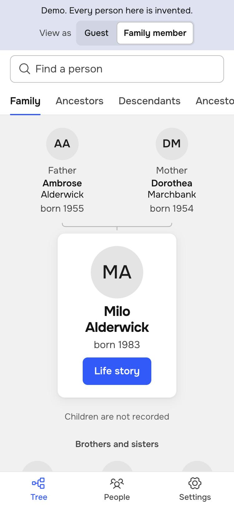
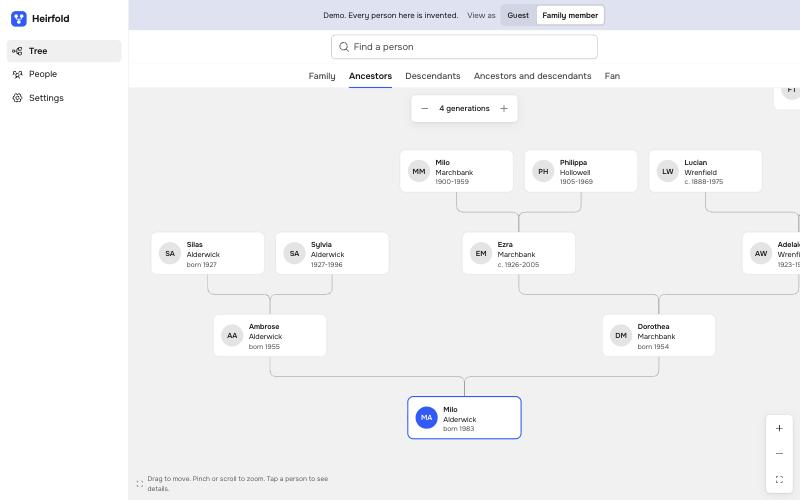

# Heirfold

Heirfold — это закрытый сайт для семейного древа. Вы запускаете его на своём сервере. Он читает файлы Gramps, работает как один бинарный файл и скрывает живых людей от гостей.

[English](README.md) · [Демо](https://renset.github.io/heirfold/) · [Паритет с Gramps Web](docs/parity.md)

[](https://github.com/Renset/heirfold/actions/workflows/ci.yml)
[](https://github.com/Renset/heirfold/actions/workflows/codeql.yml)
[](https://github.com/Renset/heirfold/actions/workflows/security.yml)

<p>
  
  
</p>

Все люди в демо и на этих картинках выдуманы.

## Статус

ВНИМАНИЕ: Heirfold — ранний проект. Не храните в нём единственную копию своих данных.

Цель проекта — полный паритет с Gramps Web. [Таблица паритета](docs/parity.md) показывает каждую функцию (на английском).

| Работает сейчас | Пока не готово |
| --- | --- |
| Импорт Gramps XML с предпросмотром и экспорт без потерь | `.gpkg` и GEDCOM |
| Прямое чтение базы Gramps 6 и автоматическая синхронизация в одну сторону | Синхронизация с Gramps Desktop в обе стороны |
| Правка в браузере: люди, родственники, события, заметки, портреты. История правок с отменой | Правка источников, цитат и мест. Слияние дублей |
| Вид «Семья», предки, потомки, песочные часы, веер, всё древо на одном полотне | Лента времени, блог, отчёты |
| Страницы людей с фотографиями и сканами. Просмотр файлов PDF, Word (.docx) и текстовых файлов | Просмотр TIFF и видео. Старые файлы Word (.doc), OpenDocument |
| Фотогалерея с отметками людей на фото. Сервер сам находит лица и подсказывает, кто это | Загрузка документов в браузере |
| Дата и место фото из файла. Фильтры по людям, годам и местам. Карта мест | Карта событий древа |
| Вход по коду из письма, четыре роли, приглашения по почте | Passkeys, двухфакторный вход, OIDC |
| Живые люди и приватные записи скрыты от гостей. Скрытые заметки только для редакторов. Журнал аудита | Полнотекстовый поиск |
| Поиск людей по имени. Русский и английский | Другие языки |

## Как попробовать

Нужны Go, Node.js и `make`.

1. Соберите бинарный файл.

   ```bash
   make build
   ```

2. Запишите в файл древо выдуманных людей.

   ```bash
   ./heirfold fixture --locale ru --out demo.gramps
   ```

3. Запустите сервер.

   ```bash
   ./heirfold serve
   ```

4. Откройте ссылку, которую напечатал сервер, и создайте администратора.
5. Откройте **Настройки**, затем **Импорт и экспорт**.
6. Загрузите `demo.gramps` или свой файл `.gramps` из Gramps Desktop.

ПРИМЕЧАНИЕ: Можно начать и с пустого древа: первого человека вы добавите в браузере.

В Heirfold нет паролей. Человек входит по коду, который сервер отправляет на его адрес почты. Сервер без настроек почты пишет код в свой вывод. На своём компьютере этого достаточно.

По умолчанию сервер доступен только на этом компьютере. Сервер для всей семьи описан в разделе [Деплой](docs/deployment.md) (на английском).

## Роли

| Роль | Что видит | Что может |
| --- | --- | --- |
| Гость | Только умерших, без приватных записей | Читать |
| Член семьи | Всё древо, кроме скрытых заметок | Читать, скачать древо, выбрать свой портрет. С отдельной настройкой: править свою ветку |
| Редактор древа | Всё древо | Править древо, добавлять фото, приглашать гостей и членов семьи |
| Администратор | Всё древо | Всё это, а также роли, учётные записи, импорт, экспорт и настройки |

Главная копия древа одна. С параметром `--gramps` её держит Gramps, а Heirfold только показывает. Без него главную копию держит Heirfold, и редакторы правят древо в браузере. Причины описаны в [ADR 0008](docs/adr/0008-editing.md).

Heirfold считает человека живым, пока нет доказательств обратного. Поэтому ошибка скрывает умершего и никогда не раскрывает живого.

## Приватность и безопасность

- Ваши данные остаются на вашем сервере. Сервер сам находит лица, называет место съёмки и рисует карту из файлов внутри программы.
- По умолчанию сервер не обращается к другим сервисам. Одна настройка, `--map-tiles`, включает карту с улицами. Тогда сервис карт видит, какие места смотрит ваша семья. Настройка описана в разделе [Деплой](docs/deployment.md).
- Content Security Policy разрешает только само приложение. Trusted Types запрещают вставку HTML из строк.
- Ничего не загружается с CDN или других источников.
- Паролей нет. Код для входа действует один раз, 10 минут и только в том браузере, который его запросил. База хранит только хеши кодов и токенов сессий.
- Каждое чтение семейных данных проходит через один фильтр приватности. Тесты проверяют его строками-маркерами.
- CI запускает CodeQL, `gosec`, Semgrep, `govulncheck`, OSV-Scanner, `npm audit`, `gitleaks`, OpenSSF Scorecard и `zizmor` для workflow. CI также собирает SBOM.

Модель угроз, известные ограничения и порядок сообщения об уязвимостях описаны в [SECURITY.md](SECURITY.md).

## Решения по архитектуре

Записи решений лежат в папке [docs/adr](docs/adr) (на английском). Внешний вид приложения описан в [DESIGN.md](DESIGN.md).

## Связь с Gramps

Heirfold — независимый проект. Он не входит в Gramps или Gramps Web, и эти проекты его не одобряли. Heirfold читает и пишет открытый формат Gramps XML. Он также читает базу SQLite программы Gramps 6 и никогда в неё не пишет. Heirfold не содержит кода этих проектов.

## Участие в разработке

Прочитайте [CONTRIBUTING.md](CONTRIBUTING.md). Главное правило: никогда не добавляйте в проект настоящие семейные данные.

## Лицензия

[AGPL-3.0-or-later](LICENSE). Лицензии библиотек, шрифтов, моделей лиц, данных карты и названий мест указаны в [THIRD_PARTY_NOTICES.md](THIRD_PARTY_NOTICES.md).
